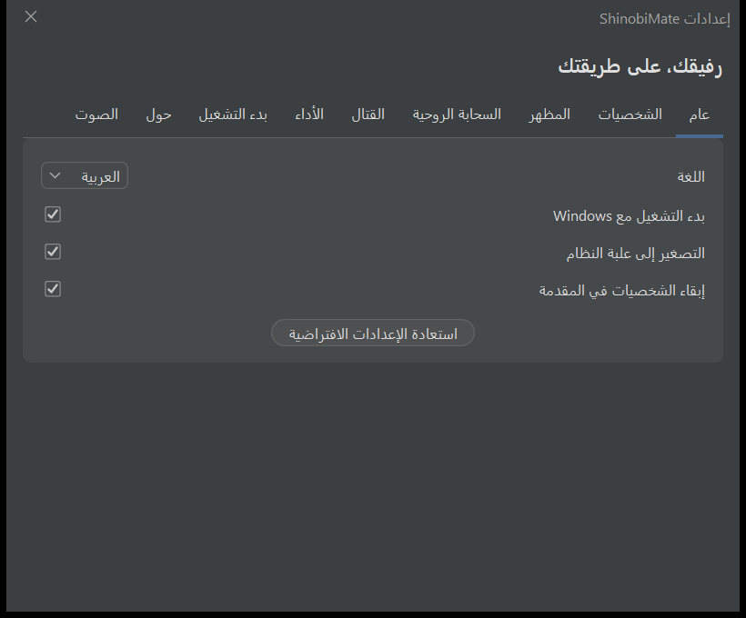
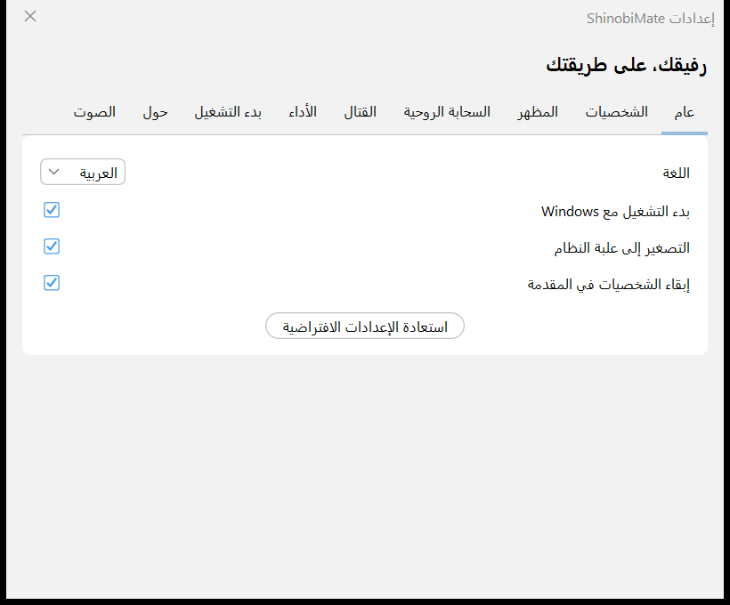
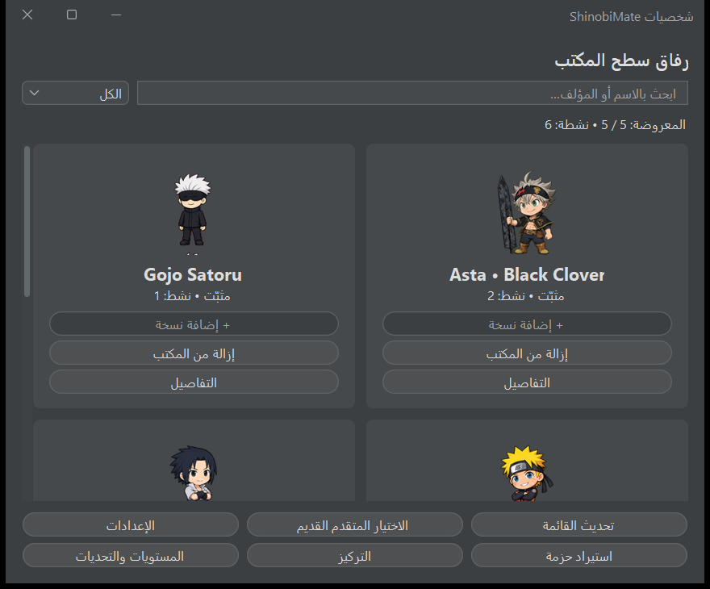
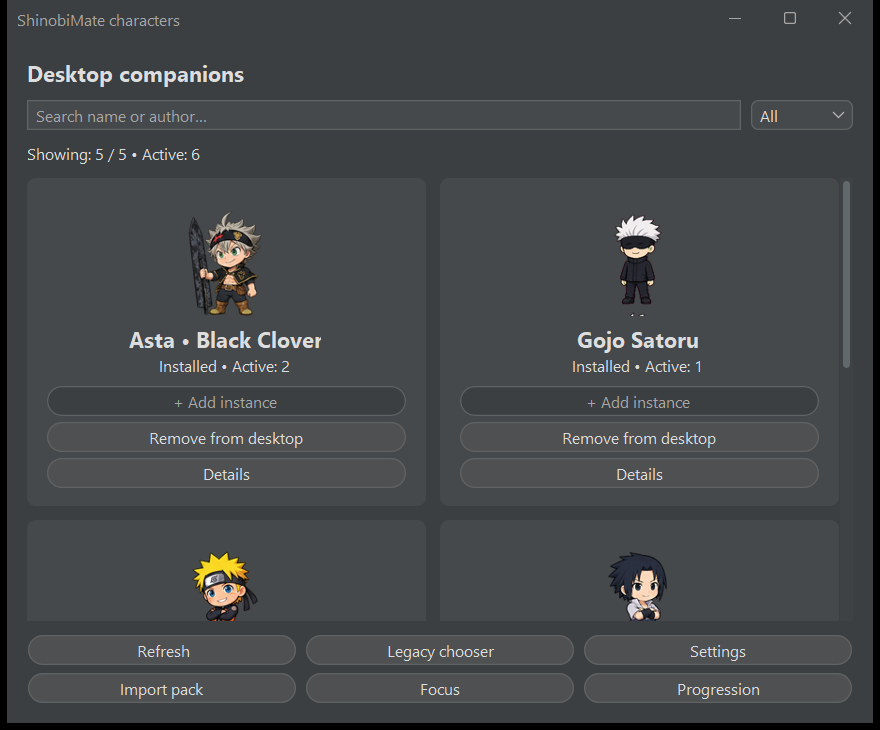
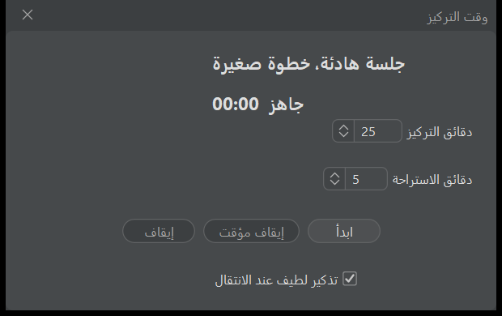
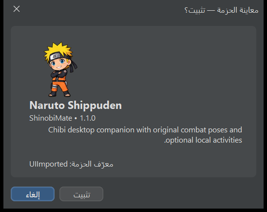
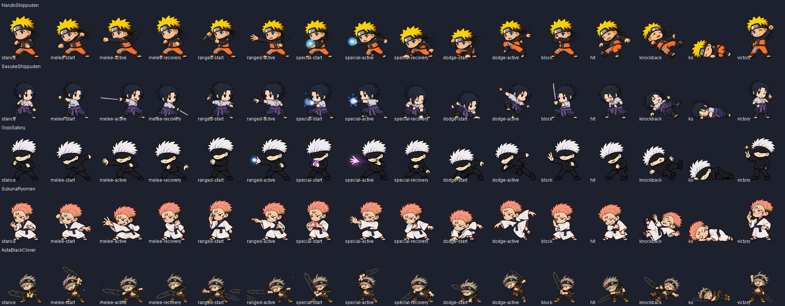

# ShinobiMate — تقرير تنفيذ مرحلة المنتج

التاريخ: 2026-10-08. نُفّذت الأولويات بالتتابع فوق النسخة المستقرة، مع البناء والفحص بعد كل أولوية. تقارير التفاصيل: [خطة التدقيق](AUDIT-PLAN.md)، [1](PRIORITY-1.md)، [2](PRIORITY-2.md)، [3](PRIORITY-3.md)، [4](PRIORITY-4.md)، [5](PRIORITY-5.md)، [6](PRIORITY-6.md)، [7](PRIORITY-7.md)، [8](PRIORITY-8.md).

متابعة التحسينات، موثّقة في 2026-10-10: [البحث والتصفية والتخطيط المرن والمعاينات وحماية التركيز وrollback عناصر الإعدادات](UX-REFINEMENTS.md). النسخة المحمولة المشار إليها هنا محدثة بهذه التحسينات، ولها 31 تحقق واجهة إضافيًا وفحص Windows ناجح.

## النتيجة القابلة للتجربة

- [ShinobiMate-Portable.zip](../../dist/ShinobiMate-Portable.zip): استخرج المجلد كاملًا وشغّل `ShinobiMate.exe`. Java 21.0.8 مضمّنة، ولا تحتاج إلى إعداد Java على جهاز المستخدم.
- البناء من المصدر ينتج [target/ShinobiMate.jar](../../target/ShinobiMate.jar). حُدّث أيضًا `Shimeji-ee/app/Shimeji-ee.jar` من البناء نفسه.
- حجم ZIP: 69,406,148 byte، نحو 66.2 MiB، و1,029 ملف تشغيل. SHA-256 للـZIP: `CFD1F64963487263ACFD73A8C10036C7C2E6A841F766FAC7D6106F9E86F518FF`. SHA-256 للـJAR في target والنسختين المحمولة والقديمة متطابق: `A1634634C1EE6195765EB0CD241ACCA1870A1AD4D02769370483CDBC6BA997DF`. [بيانات الحزمة](../../output/portable-package-info.json).
- نسخة Portable تبدأ بالدليل الأولي، ثم مدير الشخصيات والإعدادات من علبة النظام. القتال يبدأ يدويًا من زر الشخصية الأيمن → القتال → اختيار خصم.
- لم تُنفّذ أوامر git add/commit/push أو jar uf. إعدادات المستخدم الحالية في مجلدي conf بقيت محفوظة. الاختبارات تستخدم ملفات إعدادات منفصلة تحت output أو مجلدات مؤقتة خاصة بها.

## حالة المراحل

DONE تعني أن نطاق التنفيذ المذكور اختُبر فعليًا؛ القيود والتأجيلات موضّحة أسفل الجدول.

| Phase | الحالة | التنفيذ ودليل الفحص |
|---|---|---|
| 0 Audit | DONE | مراجعة دورة الإنشاء والحزم والقتال والسحابة والإعدادات وWindows/Maven/runtime؛ خطة التبعيات قبل التنفيذ |
| 1 Combat visuals | DONE | 80 وضعية قتال مستقلة للشخصيات الخمس، startup/active/recovery، charge/hit flash، مؤثرات أصلية محدودة؛ فحص الصور والمحاكاة وWindows الفعلي |
| 2 Mood | DONE | ست حالات مستقلة لكل instance، فترات ثبات وخمول وأحداث النقر/السحب/الفوز/الخسارة؛ MoodCheck |
| 3 Mouse | DONE | hover/click/double-click/drag، اتجاه النظر ووضعية النظر للأعلى، تفاعل لعوب اختياري؛ عتبة سحب موحدة تحفظ السحابة والقائمة والقتال |
| 4 Settings | DONE | ثمانية أقسام، العربية/الإنجليزية، RTL/LTR، حفظ ذري مع rollback عند الفشل وربط الإعدادات بالخدمات؛ SettingsCheck واختبار اختصار Windows في مجلد معزول |
| 5 Performance | DONE | LOW/BALANCED/HIGH/CUSTOM؛ فصل معدل الرسم عن المنطق الثابت 40ms؛ محاكاة متطابقة عبر ملفات الأداء وقياس Java 21 |
| 6 Onboarding | DONE | خمس صفحات، اختيار اللغة والشخصية، حفظ إكمال الدليل، إعادة العرض دون تغيير الشخصية الحالية؛ الصفحات الخمس باللغتين |
| 7 Character manager | DONE | بطاقات preview/status/count، تشغيل نسخ متعددة، إزالة، details/reload؛ حد العدد واختبار الإضافة المتزامنة |
| 8 Pack format | DONE | manifest v1 اختياري، قدرات ومرجعيات ورسوم مزاج/تفاعل/خمول/social، Legacy Adapter؛ الحزم الخمس والتحقق الأمني |
| 9 Import | DONE | .characterpack/.zip/.smp، staging ثم preview/metadata ثم تأكيد ونقل؛ اختبار واجهة الإلغاء والتثبيت باللغتين، رفض overwrite والحزم العدائية |
| 10 Custom cloud | DONE | طبقة Unicode مستقلة، Add/Edit/Delete/Enable، الحفاظ على نصوص الحزم؛ FocusCheck و100 نص عربي أصلي مطابق |
| 11 Focus | DONE | Pomodoro محلي قابل للتعديل، pause/resume/stop، تهدئة النشاط وتذكير اختياري واحتفال عند الإكمال؛ اختبارات النموذج والواجهة |
| 12 Idle activities | DONE | sit/sleep/stretch/train/look/relax وفق بيانات الحزمة، مقاطعة النشاط عند التفاعل وتعطيله بالمستوى صفر؛ فحص تكامل Manager |
| 13 Social | DONE | إيماءات ودية متباعدة للشخصيات القريبة واتجاه نظر متبادل، منفصلة عن Combat؛ اختبار يثبت عدم بدء القتال تلقائيًا |
| 14 XP | DONE | XP ومستويات تجميلية اختيارية لكل profile، حفظ محلي، pacing بسيط ومكافآت أحداث؛ لا تغير إحصاءات القتال |
| 15 Challenges | DONE | تحديات يومية وأسبوعية محلية وأحداث interaction/focus/battle/run-two؛ اختبار اليوم وأسابيع ISO وتغيّر السنة |
| 16 Sound | DONE | UI/Character/Combat/VFX، أربع نغمات PCM أصلية قابلة لإعادة الاستخدام، volume/mute؛ فتح أربعة Clips فعلية وإغلاقها وفحص الحدود |
| 17 Portable | DONE | app-image حقيقي عبر jpackage، runtime مضمّن وZIP مفلتر؛ تشغيل فعلي خارج مجلد التطبيق والتحقق من محتويات الأرشيف |
| 18 Installer | PARTIAL | توثيق Inno Setup 6 ووصفة تثبيت per-user واختصارات وStart Menu/startup اختياري وuninstall؛ لم يُبنَ Setup.exe لغياب ISCC.exe |
| 19 Updates | DONE | فحص HTTPS يدوي لبيانات إصدار/GitHub release، حدود حجم ومهل ومنع redirects، زر صفحة تنزيل فقط؛ خادم TLS اختباري فعلي وواجهة باللغتين |
| 20 Future store models | DONE | أنواع character/animation/theme/combat-pack وحالات FREE/PREMIUM/OWNED/LOCKED وAVAILABLE/INSTALLED؛ اختبار semantics فقط، دون متجر أو دفع |

## ما تغيّر فعليًا

القتال احتفظ بالضرر والطاقة وAI والتوقيت الأساسي. الرسوم الجديدة ليست Idle/Walk المستخدمة سابقًا كهجمات: لكل شخصية 16 وضعية شفافة 128×128، يختارها المحرك حسب مرحلة الحركة. توجد صور مستقلة للوقفة والمواجهة والهجوم والتحضير والاسترداد والدفاع والضربة وKO والانتصار؛ بعض الحركات تستخدم وضعية ثابتة أو عددًا صغيرًا من الإطارات كمرجع بصري، وليست دورات hand-drawn طويلة. charge وhit flash يضيفان 40 صورة VFX أصلية للشخصيات الخمس، مع الحفاظ على slash/impact/energy/dust/spark/projectiles السابقة. مصادر الأطالس الخمسة، prompts وخرائط القص محفوظة في `art/combat-polish/`.

واجهة المنتج تستخدم Theme مشتركًا مع FlatLaf وSegoe UI وبطاقات مستديرة وثيم فاتح/داكن. مدير الشخصيات يقرأ metadata ديناميكيًا؛ تفاصيل الحزمة تعرض author/version والقدرات. الإعدادات القديمة والاختيار المتقدم ما زالا متاحين. الميزات الجديدة تضاف إلى الحزم عبر البيانات، دون شروط خاصة بأسماء الشخصيات داخل الخدمات.

المزاج وحالة التفاعل لكل instance. XP يُحفظ لكل pack profile ويُشارك بين نسخه المتعددة. التركيز والخمول والإيماءات الودية تستخدم دورة Manager الموجودة، ولا تضيف مؤقتًا لكل شخصية. مؤقتات الواجهات تعمل فقط أثناء ظهورها، والكتابة الدورية للتقدم تستخدم writer واحدًا مع flush عند الخروج. السحابة والنقر والسحب تستخدم detector واحدًا؛ الإيماءات الاجتماعية لا تستدعي بدء القتال.

الإعدادات وcustom messages والتقدم في ملفات مستقلة، مع استبدال ذري عند توفره. الاستيراد لا يكتب إلى ملفات المحرك، ولا يسمح بتثبيت فوق ID موجود. إضافة المجلدات في الواجهة القديمة أصبحت تمر عبر validator أيضًا. [توثيق صيغة الحزمة وحدودها](PACK-FORMAT.md).

## Architecture

| الحزمة | المسؤولية |
|---|---|
| character | CharacterCatalog/Descriptor/Service، CompanionFeatures لكل instance، ContentAccess models |
| pack | JSON محدود، manifests، paths، XML آمن، validation، staging/install |
| settings | RuntimeSettings وSettingsService وSettingsStore؛ قيم محدودة وحفظ write-through |
| performance | RenderGate وPerformanceProfile؛ المنطق يبقى 25 tick/s |
| mood / interaction | آلة المزاج، حالة الماوس، SocialService منفصل |
| focus | نموذج جلسة offline وخدمة أحداث Manager |
| progression | XP/levels/challenges، حفظ محلي وwriter واحد |
| cloud | السحابة الموجودة، localization، custom-message layer |
| combat | المحرك الموجود، lifecycle/settings، stage poses، overlays محدودة |
| audio / update | clip pool أصلي، HTTPS metadata فقط |
| ui | Theme والإعدادات والمدير والدليل والمحرر والتركيز والتقدم والاستيراد والتحديث |

Main بقي نقطة بدء وربط tray/configuration والميزات القديمة؛ مسؤوليات المنتج الجديدة نُقلت إلى خدمات ونماذج مستقلة بدل وضعها كلها فيه. Manager يملك دورة المنطق والقتال والإيماءات؛ إخراج الرسم مستقل عن المنطق.

## الملفات

[FILES.csv](FILES.csv) هو القائمة الكاملة: 1,481 مسارًا، بمسار نسبي ومطلق وتصنيف NEW/MODIFIED/GENERATED/EVIDENCE، مع خمس أدوات فحص قديمة مصنفة REUSED. يتضمن كل ملف صورة ومصدر وتوثيق وأداة جديد، الملفات المعدلة، وملفات توزيع Portable المولدة. لا تُنسب تعديلات الصور أو Windows الموجودة قبل هذه المرحلة إلى هذا التنفيذ.

المصادر الجديدة: audio/SoundSystem؛ character/{CharacterCatalog,CharacterDescriptor,CharacterService,CompanionFeatures,ContentAccess}؛ cloud/CustomMessages؛ focus/{FocusService,FocusSession}؛ interaction/{InteractionState,SocialService}؛ mood/MoodState؛ pack/{JsonData,PackManifest,PackPaths,PackValidator,SafePackImporter,SecureXml}؛ performance/{PerformanceProfile,RenderGate}؛ progression/{ProgressionModel,ProgressionService}؛ settings/{RuntimeSettings,SettingsService,SettingsStore}؛ update/UpdateChecker؛ ui/{Theme,SettingsDialog,CharacterManagerWindow,OnboardingDialog,CloudEditorDialog,FocusDialog,ProgressionDialog,PackImportDialog,UpdateDialog}.

المصادر المعدلة: Main، Manager، Mascot، animation/Pose، config/ActionBuilder، script/Script، sound/Sounds، win/AutoStartManager، imagesetchooser/ImageSetChooser، packagemanager/MascotPackageManager، cloud/{CloudMessages,CloudPanel,CloudState,SpiritualCloud}، combat/{CombatProfile,CombatMatch,CombatEngine,CombatEffects}. README وCombatCheck وملفات combat.xml الخمسة في نسختي الحزم معدلة أيضًا.

البيانات الجديدة: خمسة manifests وخمسة ملفات cloud_messages_en في كل من img وShimeji-ee/img؛ 80 pose و40 charge/hitflash PNG في كل نسخة؛ الأطالس وخرائط الإخراج و45 لقطة واجهة وتقارير الأولويات والمتابعة. أسماء الأدوات والتفاصيل الفردية كلها في CSV؛ ملفات output هي أدلة فحص ولا تدخل في التوزيع.

## الاختبارات والبناء

البناء النهائي: `mvn clean package` → **BUILD SUCCESS**. Java release 21؛ JDK التطوير 25.0.3، runtime التوزيع 21.0.8. Maven لا يحتوي JUnit suite؛ الاختبارات هنا برامج Java مستقلة تستخدم المحرك الحقيقي، Swing الحقيقي، adapters داخل الذاكرة للحركة، وWindows الفعلي في الفحص المحمول. [سجل البناء](../../output/product-build.log).

| الاختبار | النتيجة الأخيرة |
|---|---|
| PolishEngineCheck | 227,167 assertions، 226,831 tick، أربعة packs × أربعة behavior profiles × ثلاث مساحات عمل |
| CharacterArtEngineCheck | 195,592 assertions، 194,849 tick، Asta/Naruto/Sasuke، الحركة والجلوس والزحف والسحب وتسلق الجدار والسقف والـcohorts |
| CombatCheck | 300,871 assertions، 72,814 tick؛ 144 مباراة seeded، ثلاث مقاييس وأصول شاشة سالبة، telegraph/cooldown/hit-once/KO، menu/stop/rematch/drag/reload/disable/resize |
| CombatVisualCheck | 380,661 assertions؛ 80 pose مستقلة شفافة وحواف آمنة وجميع الهجمات الـ24 ومراحلها |
| SpiritualCloudCheck | 11,593 assertions؛ 100 نص مطابق وpin/hover/fade/threshold و10,000 موضع شاشة وتخطيط العربية |
| SettingsCheck | 20؛ Unicode/persistence/rollback، حدود القيم، محاكاة متطابقة في أربع profiles، أقسام الواجهة الثمانية وثيمان وRTL/LTR |
| UiRefinementCheck | 31؛ البحث والتصفية والنسخ المعلقة والتخطيط المرن والمعاينات واللغة وrollback عناصر الإعدادات وحماية جلسة التركيز |
| CharacterCheck | 31؛ الحزم الخمس والنسخ المتعددة والحد والإزالة، 16 طلب إضافة بأربعة threads، الدليل الكامل باللغتين وreplay |
| PackCheck | 36؛ import/install/cancel cleanup/legacy/overwrite، traversal/ADS/device/executable/XXE/case/size، امتدادات XML/PNG الكبيرة، Rhino loop/Java boundary |
| PackImportCheck | 26؛ معاينة Swing فعلية، الإلغاء والتأكيد والmetadata وRTL/LTR باللغتين |
| MoodCheck | 46؛ حالات مستقلة وخمول واستيقاظ وثبات وسحب متكرر وفوز/خسارة وأحداث الماوس وتكامل القتال |
| FocusCheck | 25؛ transitions/pause/late clock، custom Unicode CRUD، تهدئة وتفعيل/تعطيل الخمول وsocial دون قتال، واجهات التركيز |
| ProgressionCheck | 18؛ مستويات وملفات مستقلة وحفظ وpacing وdaily/ISO-week وContentAccess |
| UpdateCheck | 11؛ TLS فعلي، نسخ جديدة/مطابقة وGitHub format، protocol/redirect/oversize/version rejection والواجهة |
| AudioCheck | 22؛ gain/mute، أربعة native Clips مفتوحة، pool محدود وإغلاق الموارد |
| StartupCheck | 8؛ .lnk فعلية في مجلد اختبار، target/working directory، spaces/apostrophe، fallback UTF-8 مع Unicode/percent؛ لم تتغير Startup الخاصة بالمستخدم |
| Portable Windows smoke | 744؛ تشغيل خارج مجلد التطبيق، الشخصيات الخمس، قائمة عربية، أزواج القتال الثلاثة، السحابة وclick-through وstop/disposal |

أكثر من 1.1 مليون تحقق ناجح عبر الاختبارات. أعداد اختبارات الحركة قد تتغير قليلًا بسبب السلوك القديم العشوائي؛ نتائج combat seeded محددة. سجلات كل check في `output/product-check/`؛ [الفحص المحمول](../../output/portable-smoke-result.txt). الاختبارات الأساسية أُعيدت بعد تعديلات Manager والأمان؛ تغييرات العرض النهائية أُتبعت بفحص الواجهات المتأثرة ثم إعادة بناء وتوزيع وفحص Windows.

إعادة الفحص من PowerShell:

```powershell
& tools/check-product.ps1
& tools/build-portable.ps1 -SkipBuild
& tools/check-distribution.ps1 -Performance
```

## Performance impact

قياس فعلي على Java 21 المضمّنة: warm-up ثانية ثم عينة خمول ثلاث ثوانٍ لكل profile، سحابة وصوت معطّلان، رسم idle بسيط. CPU كنسبة من نواة واحدة، وheap هي ذاكرة Java المستخدمة لا إجمالي الذاكرة العاملة للعملية.

هذا القياس يخص بناء المرحلة الأساسية قبل تحسينات واجهة الاستخدام اللاحقة. لم يُعَد benchmark الأداء لهذه المتابعة؛ تغيراتها في الواجهة وعدّ الحالات، ونجح فحص التشغيل المحمول للبناء الجديد.

| الشخصيات | profile | رسم Hz تقريبًا | منطق Hz تقريبًا | CPU / نواة | Heap MiB | GDI handles |
|---:|---|---:|---:|---:|---:|---:|
| 1 | LOW | 10.00 | 25.00 | 6% | 32.46 | 132 |
| 1 | BALANCED | 24.99 | 24.99 | 4% | 37.73 | 132 |
| 1 | HIGH | 25.00 | 25.00 | 4% | 39.93 | 132 |
| 5 | LOW | 10.00 | 25.00 | 10% | 50.16 | 540 |
| 5 | BALANCED | 24.99 | 24.99 | 11% | 56.85 | 540 |
| 5 | HIGH | 25.00 | 25.00 | 8% | 60.93 | 540 |

هذه عينة قصيرة وحساسة للتوقيت؛ لا تثبت أن HIGH أسرع أو أن LOW يضمن نسبة CPU محددة. عدادات المنطق والرسم تؤخذ فور نهاية العينة وقبل تكلفة قراءة GDI؛ القراءة المتأخرة في أداة القياس الأولى صُحّحت ثم أُعيد القياس. المنطق نحو 25 Hz في كل profiles، والفحص المحدد يثبت عدم تغيير منطق القتال حسب FPS. GDI ثابت بين profiles ضمن كل عينة. لم يُجرَ soak test طويل أو benchmark للقتال/VFX تحت حمل كثيف. ملفات القياس: [1](../../output/performance-1.json)، [5](../../output/performance-5.json).

LOW: 10 FPS وحد 8 VFX ودون ظل السحابة؛ BALANCED: 25 FPS/24 VFX؛ HIGH: 25 FPS/48 VFX؛ CUSTOM: 5–25 FPS وحد configurable. الحد الأقصى يحافظ على معدل المحرك الأساسي بدل تسريع المنطق. caps الأصلية للمقذوفات والمؤثرات وTTL والتنظيف بقيت قائمة.

## Regressions والإصلاحات

- صُحّح انتقال SLEEPY إلى EXCITED عند أول تفاعل بعد الخمول؛ MoodCheck يعيد الحالة والاختبار نجح.
- أزيل خطر join ذاتي عند خروج آخر instance من thread Manager؛ stop لا ينتظر thread نفسه.
- إضافة وإزالة pending mascots أصبحتا تستخدمان قفل القائمة نفسه؛ اختبار 16 طلب إضافة بأربعة threads يثبت حد شخصيتين وربط manager قبل إدراج الطلب.
- واجهة الإعدادات وبطاقات المدير أصبحتا تتبعان عرض viewport؛ صُحّح قص أزرار English ومساحة RTL الفارغة. ارتفاع اختيار onboarding محدود، واللقطات تؤخذ بعد إكمال layout.
- التحقق من امتدادات XML/PNG أصبح case-insensitive مع فحص real paths، واختبارات uppercase XXE/oversized PNG تمنع تجاوز الحدود.
- Rhino استخدم deadline تراكميًا وJava class restriction؛ حلقات غير منتهية/direct Java access مرفوضة، وتعبيرات السلوك القديم ما زالت تعمل في اختبارات المحرك.
- الصوت يغلق Clip إذا فشل فتحه، ويؤخر retry عند غياب الجهاز؛ تحديث volume/mute ينطبق على الأصوات القديمة أيضًا.
- تغيير مساحة عمل الشاشة أو تعطيل القتال يوقف المباراة وينظف overlays؛ العودة والسحب وإعادة التحميل تبقى ضمن دورة المحرك الأصلية.

## واجهات وصور

الصور مأخوذة من Swing الفعلي، لا mockups. جميع أقسام settings وصفحات onboarding باللغتين موجودة في `screenshots/`.









لقطة Windows الفعلية مع القتال والسحابة: [combat-desktop.png](../../output/combat-desktop.png). ملفات progression/custom messages/update وبقية onboarding تظهر في مجلد screenshots.

## التأجيلات وحدود التحقق

- Setup.exe وعمليات install/uninstall لم تُختبر؛ وصفة Inno Setup جاهزة ومصدرها موثق، والمترجم الخارجي غير مثبت. لا توجد MSIX أو signing حاليًا.
- يجب ضبط endpoint رسمي HTTPS لناشر المشروع من About. خدمة التحديث اختُبرت بخادم TLS fixture؛ لم يُنشر release خارجي ولم تُخترع صفحة ناشر. Auto-update أو تنزيل/تنفيذ executable مؤجل إلى وجود signing.
- مستقبل store يقتصر على models؛ لا backend أو payments أو premium enforcement/unlocks فعلية، ولا pay-to-win.
- النظر إلى المؤشر يستعمل facing ووضعيات مدعومة في الحزمة، وليس bone/IK head tracking. read activity يمكن للحزم تعريفها لاحقًا؛ الحزم الحالية تدعم ستة أنشطة أخرى.
- صيغة combat.json illustrative غير مطبقة؛ combat.xml v1 هو المصدر المعتمد للحفاظ على compatibility. Legacy custom Java action classes تُرفض عند الاستيراد؛ الحزم الخمس الحالية لا تعتمد عليها.
- تحقق multi-monitor يغطي مساحات افتراضية بأصول سالبة وأحجام مختلفة وثلاث scales. الفحص Native كان على شاشة فعلية واحدة؛ hot-plug وشاشتان فعليتان مختلفتا DPI لم تُختبرا على هذا الجهاز.
- حماية التعبيرات داخل عملية Java وليست OS sandbox؛ لا يُدّعى منع كل أشكال memory exhaustion. التحقق يراجع XML/paths/capabilities؛ engine load هو المرجع النهائي لمعاني actions/behaviors.
- Maven يعرض تحذيرات shade عن ملفات metadata مكررة بين dependencies؛ انتهى BUILD SUCCESS، ونجح تشغيل fat JAR على Java 21. لا توجد نتيجة اختبار installer أو نشر خارجي توصف بأنها ناجحة دون تنفيذها.
