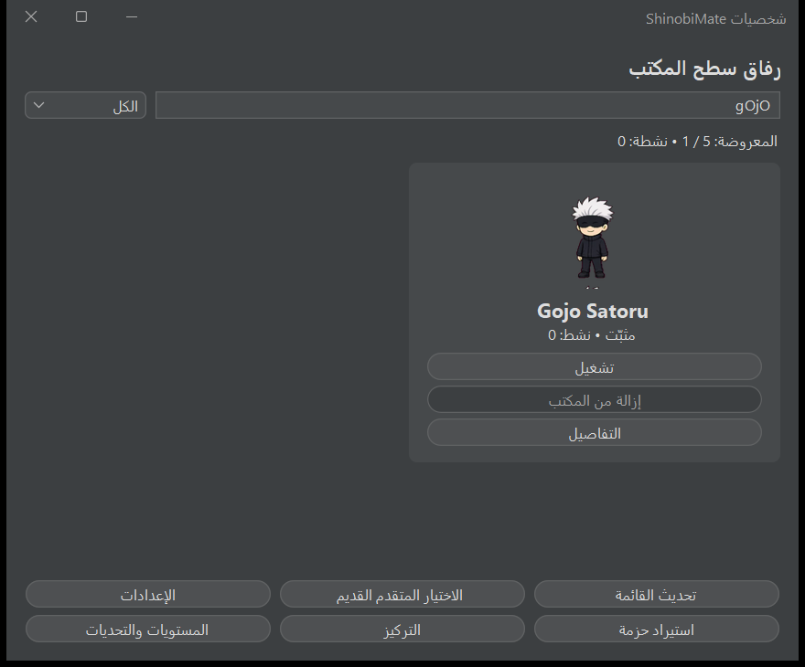
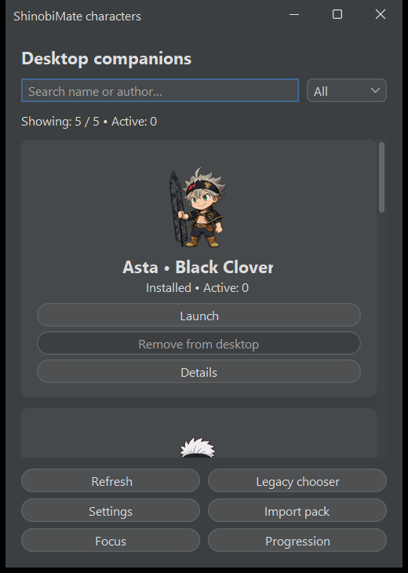
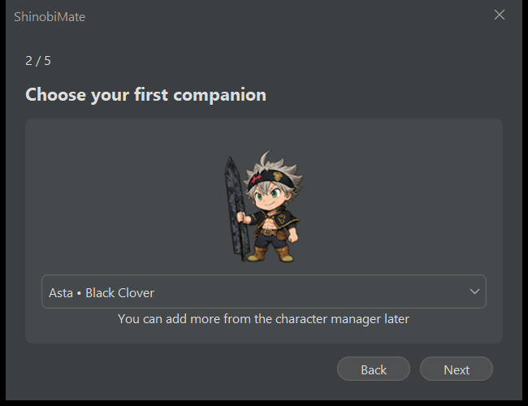

# تحسينات الاستخدام والاعتمادية

تاريخ التوثيق: 2026-10-10. هذه متابعة لطلب تحسين ما يناسب المشروع، فوق الميزات التي انتهت في التقرير الأساسي.

## التغييرات

- **مدير الشخصيات:** بحث بالاسم والمعرّف والمؤلف والوصف، يتجاهل حالة الأحرف والتشكيل العربي والتطويل. تصفية للكل أو النشطة أو قدرات القتال والسحابة والمزاج، مع عدد النتائج والنسخ النشطة وحالة واضحة عند غياب النتائج.
- **تخطيط مرن:** عند تصغير عرض النافذة تصبح البطاقات عمودًا واحدًا والأزرار السفلية عمودين؛ في النافذة الكبيرة تبقى البطاقات عمودين. حساب النتائج الرقمية معزول اتجاهيًا لتكون النسب واضحة في العربية.
- **حالة التشغيل:** النسخ التي تنتظر دورة Manager تظهر فور طلب تشغيلها، والمزالة لا تبقى نشطة في الواجهة. زر التشغيل يتوقف عند بلوغ الحد الأقصى، وزر الإزالة يتوقف عند غياب نسخ نشطة.
- **المعاينات:** تحميل مشترك محدود الأبعاد يحافظ على نسبة الصورة وشفافيتها بدل تمديدها. مدير الشخصيات يعيد استخدام المعاينات أثناء البحث؛ إعادة تحميل القائمة تمسح الـcache. الدليل الأولي يعرض معاينة الشخصية المختارة ويبدأ بالشخصية الحالية عندما تكون موجودة.
- **دليل البداية:** زر السابق معطّل في أول صفحة، ويتغير نصه مع اللغة. معاينة الشخصية تتحدث عند تغيير الاختيار، والدليل المعاد لا يستبدل الشخصيات الحالية.
- **الإعدادات:** فشل الكتابة يعيد checkbox/spinner/combobox إلى القيمة السابقة، بالتوافق مع rollback الموجود في SettingsService. عنوان الصفحة يتغير مع اللغة ويُحفظ التبويب المحدد.
- **التركيز:** جلسة جارية أو متوقفة مؤقتًا لا يمكن إعادة بدئها بالنقر على Start. مدد التركيز والاستراحة لا تُعدّل أثناء الجلسة، وتعود عناصر التحكم بعد Stop. لا تغيّر هذه الواجهة منطق توقيت الجلسة.

## الفحص

`UiRefinementCheck`: **31 تحققًا ناجحًا** عبر الواجهة الفعلية، البحث العربي/الإنجليزي، التصفية والحد والنسخ المعلقة، العرض الضيق، معاينة غير مربعة، تغيير اللغة، محاكاة فشل حفظ حقيقي وحماية جلسة التركيز.

فحوص الأجزاء المتأثرة: SettingsCheck 20، CharacterCheck 31، FocusCheck 25، PackImportCheck 26. فحص القتال بقي ناجحًا: 300,871 تحققًا، 72,814 tick و144 مباراة محددة ببذور عشوائية. الفحص المحمول على Windows/Java 21 نجح بـ744 تحققًا مع الشخصيات الخمس وأزواج القتال الثلاثة والسحابة والمؤثرات، من مجلد عمل مختلف.

البناء الأخير: **mvn clean package → BUILD SUCCESS**. ملفات JAR في target والتوزيع وShimeji-ee متطابقة بالـSHA-256. ZIP يحتوي 1,029 ملف تشغيل وruntime 21.0.8، ويخلو من المصادر والاختبارات والسجلات. لم تتغير إعدادات المستخدم بسبب الاختبارات، ولم تُنفّذ أوامر Git أو patch لملف JAR.

## الملفات

جديد: `character/CharacterFilter.java`، `ui/CharacterPreview.java`، `tools/UiRefinementCheck.java` وهذه الوثيقة وخمس لقطات واجهة.

معدّل: `character/CharacterService.java` و`ui/{CharacterManagerWindow,OnboardingDialog,SettingsDialog,FocusDialog}.java`؛ أداتا `check-product.ps1` و`write-product-inventory.ps1`، التقارير وREADME، وملفات التوزيع الناتجة من Maven.

قائمة الملفات التراكمية الكاملة: [FILES.csv](FILES.csv). سجل الفحص: [UiRefinementCheck.log](../../output/product-check/UiRefinementCheck.log).

## الصور

## النسخة

[ShinobiMate-Portable.zip](../../dist/ShinobiMate-Portable.zip)، حجم 69,406,148 byte، نحو 66.2 MiB.

ZIP SHA-256: `CFD1F64963487263ACFD73A8C10036C7C2E6A841F766FAC7D6106F9E86F518FF`.

JAR SHA-256: `A1634634C1EE6195765EB0CD241ACCA1870A1AD4D02769370483CDBC6BA997DF`.

استخدم النسخة الجديدة بعد إغلاق النسخة الجارية من ShinobiMate ثم تشغيلها مجددًا. لم تُغلق التطبيقات الجارية أثناء العمل.
